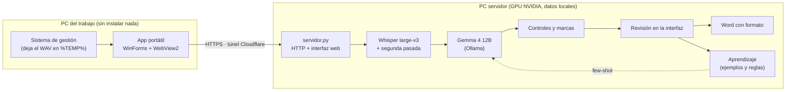

<div align="center">

# Transcripción de Informes Médicos con IA Local

**Convierte dictados de voz de diagnóstico por imágenes en informes con formato final, sin que los datos de los pacientes salgan de la PC.**


-000000)


</div>

---

## Índice

- [Qué es](#qué-es)
- [Características](#características)
- [Cómo funciona](#cómo-funciona)
- [Resultados](#resultados)
- [Requisitos](#requisitos)
- [Instalación rápida](#instalación-rápida)
- [Compilar la app de escritorio](#compilar-la-app-de-escritorio)
- [Estructura del repositorio](#estructura-del-repositorio)
- [Documentación](#documentación)
- [Privacidad](#privacidad)
- [Licencia y autoría](#licencia-y-autoría)

## Qué es

En un servicio de diagnóstico por imágenes, los médicos dictan los informes (mamografías, ecografías,
radiografías, tomografías, PET/CT) y una transcriptora los pasa a un formato fijo en Word. Los dictados
son rápidos, abreviados ("colocamos un protocolo normal pero adicionamos…", "le ponemos un 2") y llenos
de jerga, así que transcribirlos a mano lleva mucho tiempo.

Este sistema automatiza ese trabajo **de punta a punta y en forma local**:

1. **Whisper** transcribe el audio con marcas de tiempo por palabra.
2. Un **modelo de lenguaje local (Gemma 4 vía Ollama)** arma el informe usando las plantillas del servicio
   y ejemplos de informes ya corregidos.
3. Una batería de **controles automáticos** compara el informe con el dictado y marca lo que hay que revisar
   (números, lateralidad, categorías Bi-Rads/ACR, datos omitidos, tramos de audio sin transcribir).
4. La transcriptora revisa en una **interfaz web** que reproduce el audio sincronizado con el texto.
5. Se genera el **Word con el formato exacto** del servicio, y la corrección queda como **ejemplo para que la IA aprenda**.

El servidor corre en una PC con placa NVIDIA. Las PC del lugar de trabajo (donde no se puede instalar
software) se conectan con una **app portátil de Windows** que toma los audios del sistema de gestión,
los envía por un túnel cifrado y muestra la misma interfaz de revisión.

## Características

**Transcripción y generación**
- Whisper large-v3 (faster-whisper, CUDA float16) con *prompt* de vocabulario médico y VAD.
- Detección de fragmentos que Whisper omitió y **segunda pasada** solo sobre esos tramos.
- Normalización de números, horas y niveles vertebrales ("veintitrés" → 23, "hora 11" → H11, "L5, S1" → L5-S1).
- Selección automática de plantillas, ejemplos (*few-shot*) y referencias según el estudio y el médico.
- Orden de estudios impuesto por código (Mamografía → Ecografía mamaria → Categorización → Transvaginal → Tiroides).

**Revisión asistida**
- Marcas por color con la explicación de cada una (rojo: dato que no coincide; amarillo: duda; turquesa: término no dictado; gris: frase de protocolo).
- Avisos de datos dictados que no quedaron en el informe, partes no transcritas y estudios sin plantilla.
- Audio sincronizado: el cursor del informe resalta el tramo del dictado y la forma de onda; atajos de teclado tipo pedal (F2, F4, F3, F8).
- Vista previa idéntica al Word (A4, márgenes, Tahoma 12) con editor de formato (F9).
- Autocorrecciones de Word (Normal.dotm) dentro del editor, modo oscuro, modo compacto, paneles ajustables.

**Aprendizaje y medición**
- Cada informe guardado se convierte en ejemplo; las correcciones repetidas pasan a ser reglas automáticas.
- Historial de % de palabras corregidas, tiempo de revisión y estadísticas por semana, médico y estudio.

**Operación multi-PC**
- Túnel rápido de Cloudflare con descubrimiento automático de la dirección (ntfy.sh).
- Autenticación por PC (llave *Bearer* + cookie de sesión), contraseñas con PBKDF2 y bloqueo por intentos.
- App de escritorio portátil (WinForms + WebView2) con cola cifrada (DPAPI) y **actualización automática verificada**.
- Panel de administración (estado, túnel, PC vinculadas, errores, estadísticas) y registro estructurado.

## Cómo funciona



La GPU (10 GB) no admite los dos modelos a la vez: el servidor descarga Gemma antes de usar Whisper y libera
Whisper antes de llamar a Gemma. Detalles en [docs/arquitectura.md](docs/arquitectura.md).

## Resultados

Evaluación sobre 33 dictados reales comparados con el informe final escrito a mano:

| Medida | Primera versión | Versión actual |
|---|---|---|
| Palabras a corregir (promedio) | 13,0 % | **9,1 %** |
| Palabras a corregir (mediana) | 9,4 % | **7,7 %** |
| Datos críticos correctos (números, lados, categorías) | — | **94 %** |
| Tiempo de generación por informe (RTX 3080) | — | **≈ 10 s** |

Gemma 4 12B se eligió frente a Qwen 3.5 9B (13 % contra 29 % de palabras a corregir). Metodología en
[docs/pipeline.md](docs/pipeline.md#evaluación).

## Requisitos

| Componente | Requisito |
|---|---|
| Sistema operativo | Windows 10/11 (servidor y PC del trabajo) |
| GPU | NVIDIA con ≥ 10 GB de VRAM (probado con RTX 3080) |
| Python | 3.10 a 3.13 (recomendado 3.12) |
| IA local | [Ollama](https://ollama.com) con el modelo `gemma4:12b` |
| App del trabajo | .NET Framework 4.8 y WebView2 Runtime (incluidos en Windows 10/11 actualizados) |

## Instalación rápida

El sistema espera las carpetas de datos **al lado** del código, así que conviene clonar el repositorio
dentro de una carpeta propia con el nombre `sistema`:

```bat
mkdir "C:\Transcripcion" && cd /d "C:\Transcripcion"
git clone https://github.com/<usuario>/<repositorio>.git sistema
cd sistema
instalar.bat                 :: crea .venv, instala dependencias y descarga Whisper (~3 GB)
ollama pull gemma4:12b       :: modelo de lenguaje
interfaz.bat                 :: abre http://127.0.0.1:8765
```

En el primer arranque se crean `configuracion.json` y `conocimiento/` a partir de los archivos de ejemplo.
Después hay que cargar las plantillas propias del servicio (botón **Plantillas** de la interfaz).
Para habilitar el acceso desde otras PC: `configurar_acceso.bat` y luego `iniciar_servidor.bat`.

Guía completa: [docs/instalacion.md](docs/instalacion.md).

## Compilar la app de escritorio

La app de las PC del trabajo está en [`cliente_codigo/`](cliente_codigo/) (C# · .NET Framework 4.8 · WebView2).

**En Windows** (con el [.NET SDK](https://dotnet.microsoft.com/download)):

```bat
cd cliente_codigo
dotnet build -c Release
```

**En Linux con Mono** (es como se compilan las versiones publicadas):

```bash
sudo apt install mono-mcs mono-devel
./cliente_codigo/compilar.sh          # genera cliente/Transcripcion.exe
```

> [!IMPORTANT]
> Mono acepta métodos que .NET Framework 4.8 no tiene (por ejemplo `string.TrimEnd(char)`): el programa compila
> pero falla en Windows con *"Método no encontrado"*. Leé las reglas en [docs/compilacion.md](docs/compilacion.md)
> antes de cambiar código de la app.

Para publicar una versión nueva basta con copiar el `.exe` a la carpeta `cliente\` del servidor:
cada PC se actualiza sola después de verificar que la versión nueva funciona con su .NET.

## Estructura del repositorio

```
├── servidor.py              Servidor HTTP, cola de procesamiento y API de la interfaz
├── nucleo.py                Prompt, selección de plantillas/ejemplos, llamada a Ollama y controles de revisión
├── fase1_transcribir.py     Whisper, lectura de audio y normalización del texto
├── huecos.py                Detección de tramos no transcritos y segunda pasada
├── informe.py               Generación del Word (python-docx) y modo consola
├── aprender.py              Ejemplos aprendidos, historial y correcciones frecuentes
├── paciente.py              Nombre del paciente para la lista (nunca va a la IA ni al informe)
├── importar_informes.py     Importa informes Word como referencias o plantillas
├── remoto.py                Túnel de Cloudflare, publicación en ntfy, llaves y sesiones
├── admin.py                 Permisos y lectura de registros para el panel
├── estadisticas.py          Métricas de calidad y tiempo de revisión
├── registro.py              Consola con colores, archivos de log y actividad.csv
├── app_cliente.py           Manifiesto de actualización de la app del trabajo
├── configurar_acceso.py     Contraseña del acceso remoto y PC autorizadas
├── web/                     Interfaz de revisión, panel de administración y estadísticas
├── cliente_codigo/          Código fuente de la app de Windows (C#)
├── cliente/                 Carpeta de distribución de la app (solo el manual y el .config se versionan)
├── conocimiento.ejemplo/    Plantillas y reglas de ejemplo (ficticias)
├── configuracion.ejemplo.json
├── vocabulario.txt          Términos médicos sugeridos a Whisper
├── requirements.txt
├── *.bat                    Instalación y arranque en Windows
└── docs/                    Documentación técnica
```

## Documentación

| Documento | Contenido |
|---|---|
| [Arquitectura](docs/arquitectura.md) | Componentes, flujo de un audio, uso de GPU, concurrencia y archivos de un caso |
| [Instalación](docs/instalacion.md) | Puesta en marcha del servidor, del acceso remoto y de las PC del trabajo |
| [Uso diario](docs/uso.md) | Flujo de revisión, atajos de teclado y significado de las marcas |
| [Pipeline de IA](docs/pipeline.md) | Transcripción, armado del prompt, controles, aprendizaje y evaluación |
| [Configuración](docs/configuracion.md) | `configuracion.json`, formato de plantillas, reglas, médicos y vocabulario |
| [Acceso remoto](docs/acceso-remoto.md) | Túnel, descubrimiento de la dirección, autenticación y app del trabajo |
| [Compilación](docs/compilacion.md) | Compilar, verificar y publicar la app de escritorio |
| [Administración](docs/administracion.md) | Panel, estadísticas, registros y borrado de informes |
| [API HTTP](docs/api.md) | Rutas del servidor |
| [Seguridad y privacidad](docs/seguridad.md) | Datos que maneja el sistema y cómo se protegen |
| [Desarrollo](docs/desarrollo.md) | Modo simulado, convenciones, pruebas y lecciones aprendidas |
| [Historial de cambios](CHANGELOG.md) | Versiones del servidor y de la app |

## Privacidad

- **Todo el procesamiento es local**: audio, transcripción, IA y documentos quedan en la PC servidor.
- El túnel solo expone la interfaz web, protegida por autenticación; ningún dato clínico pasa por servicios de terceros
  más allá del transporte cifrado de Cloudflare.
- El nombre del paciente se usa solo para identificar el caso en la lista: **nunca** se envía a la IA ni va al informe.
- Este repositorio **no contiene datos de pacientes, plantillas reales, credenciales ni configuraciones**
  (ver [.gitignore](.gitignore) y [docs/seguridad.md](docs/seguridad.md)).

## Licencia y autoría

Desarrollado por **Rodrigo Espíndola**. © 2026 — Todos los derechos reservados.
El código se publica solo para consulta; ver [LICENSE](LICENSE).
