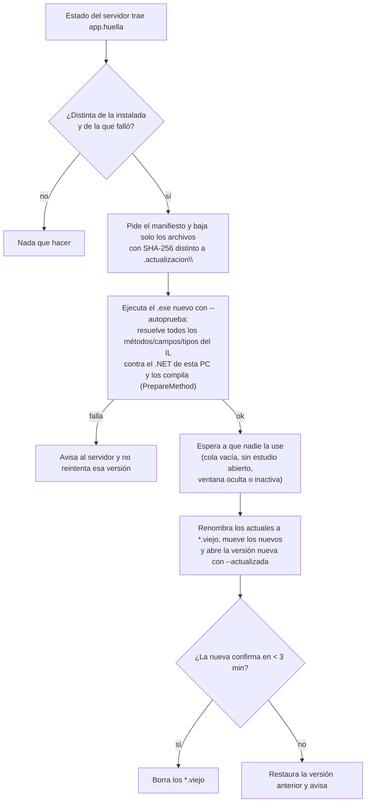

# Acceso remoto y app del trabajo

## Contexto y restricciones

- El servidor corre en una PC con GPU fuera de la red del lugar de trabajo.
- En el trabajo hay varias PC compartidas por varias personas, donde **no se pueden instalar programas ni ejecutar scripts**.
- El sistema de gestión del lugar copia el audio del informe a `%TEMP%` al abrirlo (WAV con cabecera RIFF) y lo
  borra al cerrarlo.

Por eso se eligió un **túnel rápido de Cloudflare** (`cloudflared tunnel --url`, sin cuenta) y una **app portátil**
que no requiere instalación. Se descartaron las VPN tipo Tailscale porque requieren instalar un cliente.

## Túnel y descubrimiento de la dirección

```mermaid
sequenceDiagram
    participant S as Servidor
    participant C as cloudflared
    participant N as ntfy.sh (canal secreto)
    participant A as App del trabajo
    S->>C: cloudflared tunnel --url http://127.0.0.1:8765
    C-->>S: https://<aleatorio>.trycloudflare.com
    S->>N: publica la dirección (se repite cada 3 h; el mensaje dura 12 h)
    A->>N: consulta el último mensaje del canal
    N-->>A: dirección actual
    A->>C: HTTPS con llave Bearer de la PC
    C->>S: pedido con encabezados Cf-Ray / Cf-Connecting-Ip
```

- La dirección cambia en cada reinicio del túnel; la app la redescubre sola.
- El nombre del canal de ntfy es aleatorio y se guarda en `acceso_remoto.json` (servidor) y `cliente/conexion.json`
  (app). **Ninguno de los dos archivos se versiona.**
- Si la red bloquea ntfy, la dirección se puede escribir a mano en la app (*Opciones → Configuración… → Conexión → Cambiar dirección…*).
- El túnel rápido no tiene disponibilidad garantizada ni admite SSE; la interfaz consulta el estado cada 2 s, así
  que no le afecta. El panel de administración permite reiniciarlo y volver a publicar la dirección.

### Alternativa: Microsoft Dev Tunnels (servidor 2026.10.30, app 1.12)

`configurar_tunel.bat` / `.sh` elige el servicio (`acceso_remoto.json` → `tunel.servicio`: `cloudflare` o `devtunnel`).
Con Dev Tunnels:

- Solo la PC del servidor necesita una cuenta (Microsoft o GitHub): `devtunnel user login`. Las PC del trabajo
  entran sin cuenta porque el túnel se crea con `--allow-anonymous`; la contraseña y las llaves del sistema siguen
  protegiendo todo.
- Túnel persistente (`devtunnel create transcripcion-xxxxxxxx --allow-anonymous --expiration 30d` + `port create -p 8766`):
  la dirección `https://<id>-8766.<región>.devtunnels.ms` no cambia con los reinicios. Se publica igual en ntfy.
- `devtunnel host <id>` reenvía al **puerto propio del túnel** (`PUERTO_TUNEL`, 8766, solo 127.0.0.1). El servidor
  atiende ese puerto con `HTunel`, que trata todo pedido como remoto (no depende de `X-Forwarded-For` ni de `Host`).
  La IP mostrada sale de `X-Forwarded-For`.
- La app 1.12 manda `X-Tunnel-Skip-AntiPhishing-Page: true` (HttpWebRequest y WebView2 `WebResourceRequested`)
  para no ver la página intermedia de Microsoft.
- Si Microsoft borró el túnel por falta de uso, el servidor lo recrea con el mismo nombre; si venció la sesión,
  queda en estado `sin_sesion` hasta que se vuelva a iniciar sesión con `configurar_tunel` (opción 3).

## Autenticación

| Origen del pedido | Requisito |
|---|---|
| `127.0.0.1` sin encabezados de Cloudflare | Ninguno (uso local). Con transcriptores: su usuario y contraseña |
| Por el túnel | Llave *Bearer* de una PC vinculada **o** cookie de sesión. Con transcriptores, la llave sola solo sirve para enviar audios, el estado y las actualizaciones; ver informes exige la sesión de un transcriptor |
| Panel de administración por el túnel | Lo anterior **y** la contraseña del panel (sesión de 8 h, 30 min de inactividad) |

- **Vinculación**: en el primer uso, la app envía el nombre de la PC (desde la 1.23, el de Windows) y la contraseña
  de acceso remoto o, si hay transcriptores, el usuario y la contraseña de uno de ellos; el servidor entrega una
  llave propia de esa PC (guardada cifrada con DPAPI en la PC). Con usuario, devuelve además un código de entrada
  que abre la pantalla ya con esa persona.
- **Entrada a la pantalla**: la app obtiene un código de un solo uso válido por 60 s y abre la interfaz con él.
  Con transcriptores, la pantalla pide usuario y contraseña en `/ingresar` (no `/entrar`, que la app intercepta para
  volver a entrar sola con la llave). La sesión dura mientras la app esté abierta, también escondida junto al reloj;
  termina con «Cerrar sesión», «Salir» o tras 12 h sin consultas. Ver [usuarios.md](usuarios.md).
- **Contraseñas**: PBKDF2 con sal. Cinco intentos fallidos bloquean esa IP (o esa PC, en el panel) durante 10 minutos.
- **Cookies**: `HttpOnly`, `Secure`, `SameSite=Strict`. La cookie del panel está atada a la PC: si aparece en otra, se anula.
- Todas las respuestas llevan `Cache-Control: no-store`.
- Una PC se puede anular desde el panel o con `configurar_acceso.bat`; eso invalida su llave y sus sesiones.

## App del trabajo (`cliente_codigo/`)

C# para .NET Framework 4.8 con Windows Forms y WebView2. Archivos:

| Archivo | Responsabilidad |
|---|---|
| `Programa.cs` | Punto de entrada, instancia única, configuración (`%LOCALAPPDATA%\Transcripcion\config.json`), versión y argumentos (`--autoprueba`, `--actualizada`, `--oculta`) |
| `VentanaPrincipal.cs` | Ventana, barra de estado, WebView2, modo compacto, menú Opciones, ícono de bandeja, mensajes con la página |
| `VentanaVincular.cs` | Primer uso: nombre de PC y contraseña |
| `Servidor.cs` | Cliente HTTP, descubrimiento por ntfy, normalización de la dirección |
| `Audios.cs` | Vigilancia de `%TEMP%\*.wav` y cola cifrada de envío |
| `Actualizador.cs` | Actualización automática verificada |
| `Autocorreccion.cs` | Lectura de autocorrecciones con formato del Normal.dotm |
| `Estilo.cs` | Colores y tema |

### Toma de audios

- Vigila `%TEMP%\*.wav`; espera a que el tamaño sea estable y la cabecera RIFF esté completa.
- Abre el archivo con `FileShare.ReadWrite | Delete` para no bloquear al sistema de gestión.
- Descarta archivos de menos de 8 KB y no repite huellas.
- Sin conexión, los audios quedan en una cola cifrada con DPAPI y se envían cuando vuelve la conexión.

### Comunicación con la página

La página detecta la app y se comunica con `chrome.webview.postMessage`:

| Mensaje (página → app) | Efecto |
|---|---|
| `{accion: 'agrandar' \| 'compacto'}` | Cambia el tamaño de la ventana |
| `{accion: 'tema', ...}` | Sincroniza el tema de la barra de la app |
| `{accion: 'audio', id, nombre, datos}` | Audio cargado a mano: pasa por la cola cifrada |
| `{accion: 'autocorreccion'}` | Pide la lista de autocorrecciones |
| `{accion: 'configuracion'}` | Pide el estado de la app para la ventana de Configuración (1.9) |
| `{accion: 'cfg', que, valor}` | Cambio desde Configuración (1.9): `inicio`, `tomar`, `avisar` (con `valor` true/false), `compacto`, `abrirWord`, `cambiarWord`, `wordPorDefecto`, `registro`, `autocorreccion`, `recargar`, `direccion` (`valor` = URL), `desvincular` (la página ya confirmó), `actualizar` |

La app responde llamando funciones de la página (`ponerApp`, `audioEnCola`, `ponerAutocorreccion`, `ponerConfigApp`) con `ExecuteScriptAsync`.
Opciones → *Configuración…* llama a `abrirConfiguracion(estado, seccion)`; si la página no la tiene o no está cargada,
la app abre su propia ventana con las opciones de la PC.

### Actualización automática

Criterio de diseño: la app es lo más "tonta" posible; todo lo nuevo va en la página web del servidor y el `.exe`
solo cambia cuando hace falta algo de Windows.



- El servidor (`app_cliente.py`) publica un manifiesto de `sistema\cliente` con el SHA-256 de cada archivo:
  `Transcripcion.exe`, `Transcripcion.exe.config`, `LEEME.txt`, `conexion.json` y las `.dll` (incluida `runtimes\`).
  Se ignoran los archivos `.viejo`, `.nuevo`, `.fallida` y las carpetas que empiezan con punto.
- La versión se lee de la `FileVersion` del `.exe`.
- El registro del servidor muestra qué PC bajó, instaló o rechazó cada versión.

Para publicar una versión: ver [compilacion.md](compilacion.md#publicar-una-versión).
