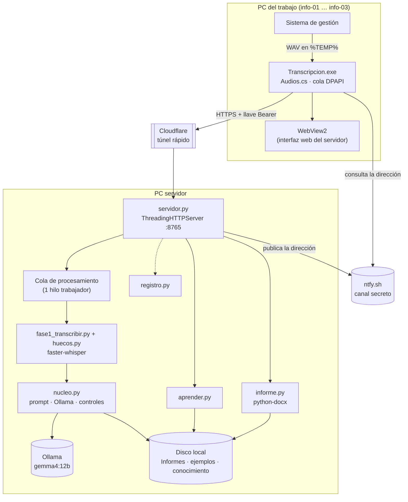
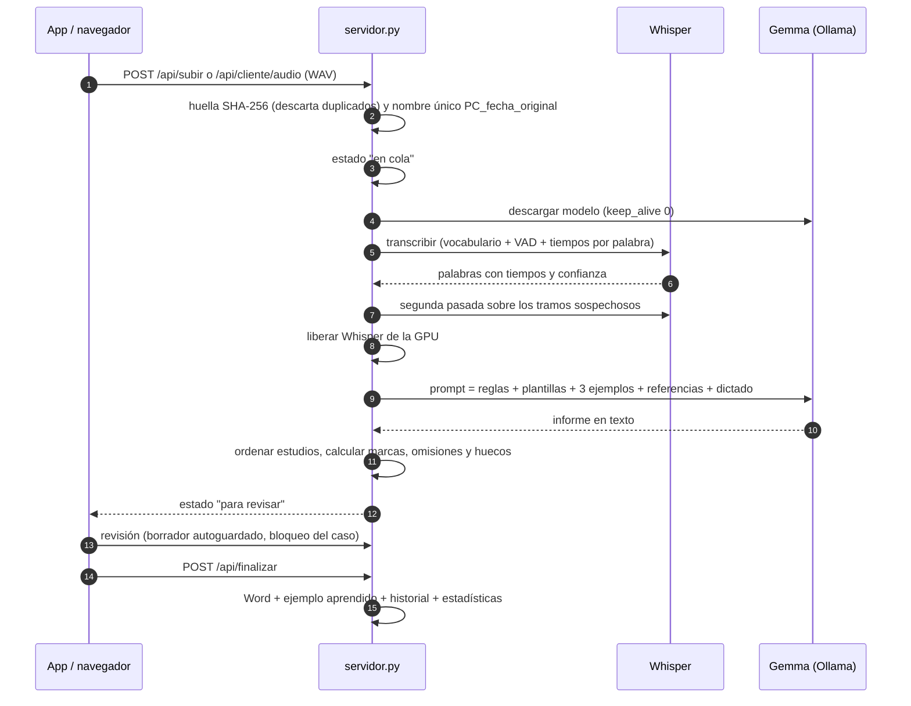

# Arquitectura

## Visión general

El sistema tiene dos piezas:

- **Servidor** (Python, una sola PC con GPU NVIDIA): recibe audios, los transcribe, genera el informe con un
  modelo de lenguaje local, calcula las marcas de revisión, sirve la interfaz web y escribe el Word.
- **App del trabajo** (C# · WinForms · WebView2): ejecutable portátil para PC donde no se puede instalar software.
  Toma los audios que deja el sistema de gestión, los envía al servidor y muestra la interfaz del servidor dentro
  de su ventana.



## Módulos del servidor

| Módulo | Responsabilidad |
|---|---|
| `servidor.py` | Servidor HTTP (`ThreadingHTTPServer`), rutas de la API, cola y trabajador, bloqueos de casos, borrado, panel de administración |
| `fase1_transcribir.py` | Carga de Whisper, lectura de WAV propia, normalización de texto y números, extracción de datos críticos |
| `huecos.py` | Busca regiones con energía de voz y sin palabras, y las re-transcribe |
| `nucleo.py` | Plantillas, detección de estudio, armado del prompt, selección de ejemplos/referencias, llamada a Ollama, orden de estudios, marcas y omisiones |
| `paciente.py` | Extrae el nombre del paciente del inicio del dictado (solo para la lista) |
| `informe.py` | Configuración, párrafos con formato, Word (A4, Tahoma, negritas, centrado) y modo consola |
| `aprender.py` | Ejemplos aprendidos, `historial.csv`, `correcciones_aprendidas.md` |
| `importar_informes.py` | Convierte informes Word en referencias o en plantillas |
| `remoto.py` | Túnel (`cloudflared`), publicación en ntfy, contraseñas PBKDF2, llaves por PC, sesiones y cookies |
| `admin.py` | Permisos del panel y lectura de los registros |
| `estadisticas.py` | Métricas de calidad y tiempo (solo lectura) |
| `registro.py` | Consola con colores, título de ventana, logs diarios, `actividad.csv` |
| `app_cliente.py` | Manifiesto (SHA-256) de la carpeta `cliente\` para la actualización automática |

La interfaz está en `web/` y no usa *frameworks* ni dependencias externas: `index.html` (revisión),
`admin.html` (estado) y `estadisticas.html`.

## Flujo de un audio



## Uso de la GPU

La placa de 10 GB no admite Whisper large-v3 y Gemma 12B a la vez. El trabajador procesa **un audio por vez** y:

1. Antes de transcribir, pide a Ollama que descargue el modelo (`keep_alive: 0`).
2. Después de transcribir, libera Whisper de la memoria de la placa.
3. Llama a Gemma con `temperature 0.1`, `num_ctx 12288` y sin modo de razonamiento.

Si Ollama está cerrado, el audio igual se transcribe y queda esperando; la vigilancia de la IA (cada 20 s)
reanuda la cola cuando vuelve.

## Concurrencia y varias PC

- El servidor atiende pedidos en paralelo (un hilo por conexión) pero procesa audios en un solo trabajador.
- **Bloqueo de casos**: un caso abierto queda tomado por esa PC durante 45 s, renovado cada 15 s; otra PC puede verlo pero no modificarlo.
- Las escrituras de `finalizar` y del formato van serializadas (`FIN_LOCK`, `FMT_LOCK`).
- **Duplicados**: cada audio se identifica por SHA-256 (`_huellas.json`).
- Cada PC tiene su médico predeterminado guardado en el servidor; la lista se puede filtrar por "Esta PC / Todas".

## Archivos de un caso

Para un audio `NOMBRE`, el servidor guarda en `Informes\revision\datos\`:

| Archivo | Contenido |
|---|---|
| `NOMBRE.json` | Transcripción con tiempos por palabra y huecos |
| `NOMBRE.dictado.txt` | Texto del dictado |
| `NOMBRE.informe_ia.txt` | Salida de la IA |
| `NOMBRE.marcas.json` | Marcas de revisión (versionadas con `"v"`) |
| `NOMBRE.borrador.html` | Borrador editado (autoguardado) |
| `NOMBRE.final.txt` | Texto final guardado |
| `NOMBRE.formato.json` | Formato manual (vista previa / autocorrecciones) |
| `NOMBRE.paciente.json` | Nombre del paciente detectado o corregido |
| `NOMBRE.revision.json` | Segundos de revisión activa por PC |
| `NOMBRE.onda.json` | 1600 picos para dibujar la forma de onda |
| `NOMBRE.medico.txt`, `.origen.txt`, `.original.txt` | Médico, PC de origen y nombre original del audio |

El Word final queda en `Informes\NOMBRE.docx`.

## Estructura de carpetas en la PC servidor

```
<carpeta del sistema>\
├── Audios_nuevos\          audios recibidos (no versionado)
├── Informes\               Word generados y datos de revisión (no versionado)
└── sistema\                este repositorio
    ├── conocimiento\       plantillas y reglas reales (no versionado)
    ├── ejemplos\           informes aprendidos (no versionado)
    ├── referencias\        informes Word convertidos a texto (no versionado)
    ├── resultados\         evaluaciones e historial (no versionado)
    ├── registros\          logs (no versionado)
    └── cliente\            distribución de la app del trabajo
```
