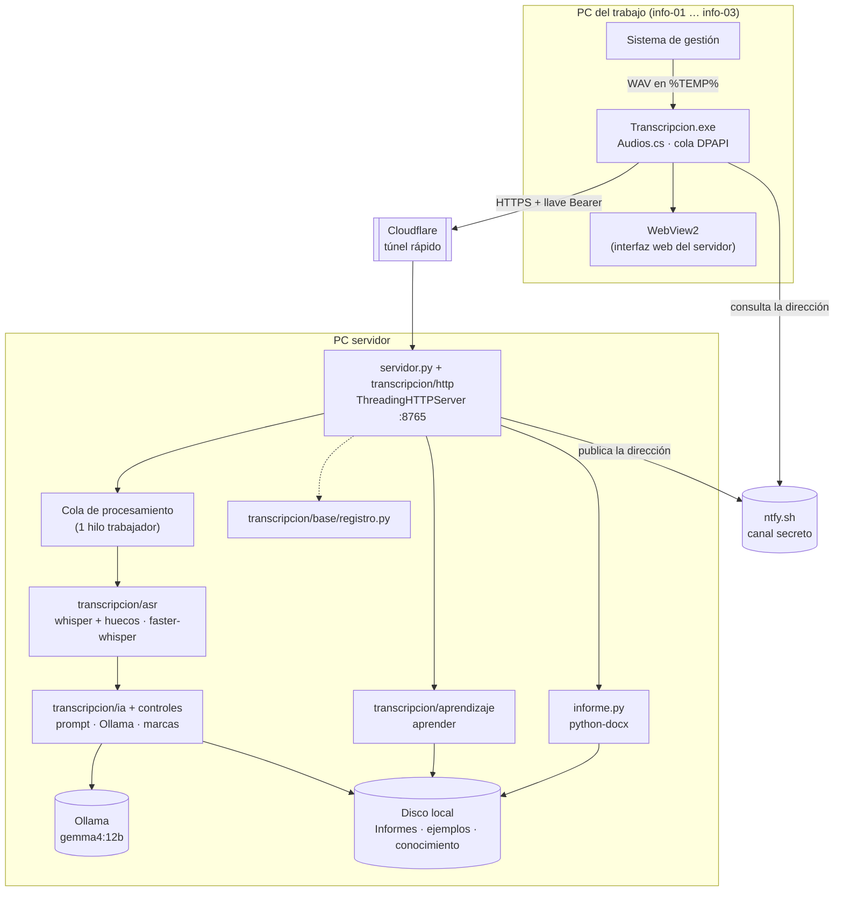
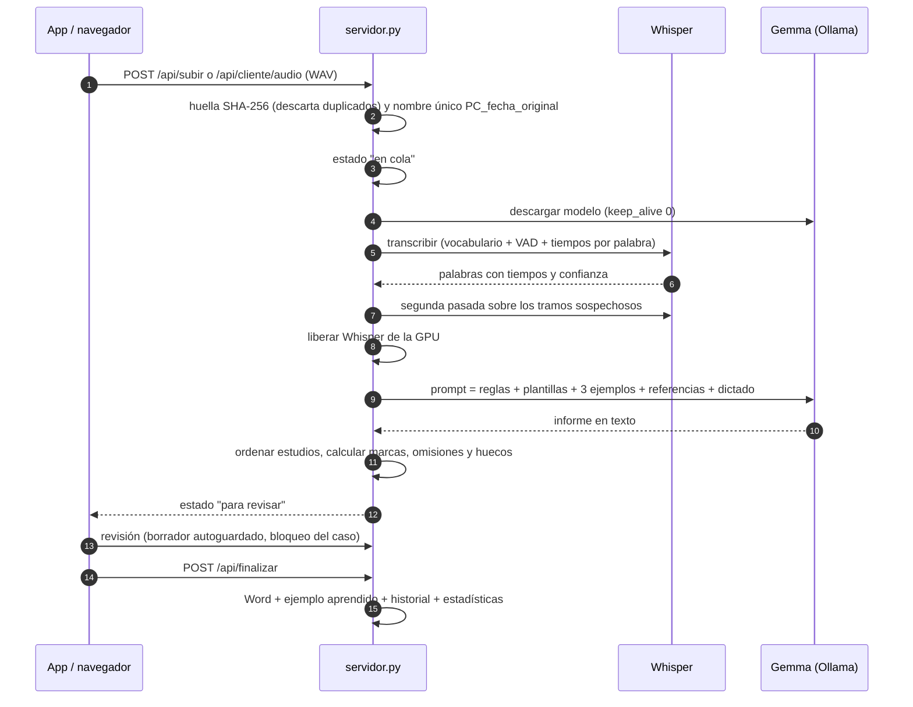

# Arquitectura

## Visión general

El sistema tiene dos piezas:

- **Servidor** (Python, una sola PC con GPU NVIDIA): recibe audios, los transcribe, genera el informe con un
  modelo de lenguaje local, calcula las marcas de revisión, sirve la interfaz web y escribe el Word.
- **App del trabajo** (C# · WinForms · WebView2): ejecutable portátil para PC donde no se puede instalar software.
  Toma los audios que deja el sistema de gestión, los envía al servidor y muestra la interfaz del servidor dentro
  de su ventana.



## Módulos del servidor

Los módulos se están pasando por etapas al paquete `transcripcion/` ([refactor.md](refactor.md)). Los que siguen
en la raíz son los puntos de entrada y lo que todavía no se reorganizó.

| Módulo | Responsabilidad |
|---|---|
| `transcripcion/ajustes.py` | Ajustes del arranque (`configuracion.json` + variables de entorno) como objeto; crea las carpetas de trabajo solo cuando se lo piden. Ningún módulo lee la configuración al importarse |
| `transcripcion/__init__.py` | `RAIZ`: la carpeta del sistema. Los datos de la instalación (registros, usuarios, conocimiento…) se ubican desde ahí, no desde la carpeta del paquete |
| `transcripcion/base/` | `plataforma` (Windows/Linux), `persistencia` (escritura atómica), `registro` (consola con colores, título de ventana, logs diarios, `actividad.csv`) |
| `transcripcion/casos/` | `borradores` (borrador con control de revisión), `paciente` (nombre del paciente para la lista, nunca va a la IA ni al informe), `indice` (metadatos del listado) |
| `transcripcion/procesamiento/` | `cola` (cola SQLite duradera), `lotes` (lotes FIFO de IA), `cache_transcripcion` (reutilizar Whisper) |
| `transcripcion/aprendizaje/` | `almacen` (correcciones e historial en SQLite), `pendiente` (cola persistente de aprendizaje) |
| `transcripcion/acceso/` | `usuarios` (transcriptores, contraseñas y estilo propio) |
| `servidor.py` | Arranque: `configurar` crea los objetos de abajo y el `Sistema` de las rutas; `main` abre el puerto, los hilos y el túnel; encabezado de la consola |
| `transcripcion/http/` | `manejador` (lee el pedido, autoriza y despacha), `tabla` (todas las rutas: método y ruta → función), `rutas` (`Rutas`, `Pedido`, fases de un POST), `sistema` (`Sistema`: lo que usan las rutas) y una función por ruta en `acceso`, `paginas`, `casos`, `edicion`, `audios`, `cliente`, `conocimiento`, `voces`, `usuario`, `panel` (+ `panel_estado`, `panel_acciones`). Las páginas de entrar y del panel desde el trabajo están en `web/plantillas/` |
| `transcripcion/procesamiento/trabajador.py` | `Trabajador` (`TRAB`): lotes de la cola, Whisper + segunda pasada, voz, IA, marcas; recuperación de la cola duradera al arrancar y resultados ya completos |
| `transcripcion/casos/vista.py`, `borrado.py` | `VistaCasos` (`VISTA`): lista, caso abierto, marcas para la web, forma de onda · `Borrado` (`BORRADO`): permisos y borrado recuperable |
| `transcripcion/operacion/ia.py`, `reinicio.py` | `EstadoIA` (`IA`): Ollama responde/tiene el modelo, vigilancia, espera del trabajador · `Operacion` (`OPER`): reinicio programado y mensajes a las PC |
| `transcripcion/informe/guardado.py`, `word.py` | `Guardado` (`GUARDADO`): «Guardar Word y aprender» y vista previa · `word`: párrafos, formato y escritura del .docx |
| `transcripcion/asr/` | `whisper` (bibliotecas de CUDA, carga del modelo, lectura de WAV propia, vocabulario como prompt, transcripción con tiempos por palabra), `huecos` (regiones con voz y sin palabras, segunda pasada) |
| `transcripcion/texto/normalizacion.py` | Números en palabras a cifras, horas, niveles vertebrales, sin acentos y datos críticos |
| `herramientas/fase1_transcribir.py` | Herramienta: evaluación de Whisper sobre audios de ejemplo (reporte HTML) y `--verificar` (lo usan los instaladores) |
| `transcripcion/conocimiento/` | `archivos` (carpeta `conocimiento/`, `CONOC`, `preparar_conocimiento`), `plantillas` (secciones generales y propias, categorías, títulos, texto fijo, plantillas relevantes para un dictado), `medicos` (notas generales y propias) |
| `transcripcion/ia/` | `prompt` (instrucciones y armado de mensajes), `ejemplos` (banco, selección few-shot, referencias), `ollama` (cliente de Ollama, orden de estudios aplicado a la salida, liberar la GPU) |
| `transcripcion/controles/` | `marcas` (marcas con su motivo, alineación con el dictado, HTML, palabras raras), `clinicos` (Bi-Rads, ACR, términos clave), `avisos` (datos omitidos, estudios sin plantilla), `orden` (orden de estudios) |
| `transcripcion/informe/formato.py`, `transcripcion/texto/palabras.py` | Negritas del Word; palabras normalizadas para comparar textos |
| `informe.py` | Lectura de la configuración para el modo consola (vía `ajustes`), párrafos con formato, Word (A4, Tahoma, negritas, centrado) y modo consola |
| `transcripcion/aprendizaje/aprender.py`, `correcciones.py` | `aprender`: ejemplos aprendidos, `historial.csv`, `correcciones_aprendidas.md` (lanzador de consola: `aprender.py`) · `correcciones`: cambios frecuentes IA → informe final para el panel |
| `transcripcion/conocimiento/importar.py` | Convierte informes Word en referencias o en plantillas (lanzador de consola: `importar_informes.py`) |
| `transcripcion/acceso/remoto.py` | Túnel (`cloudflared`), publicación en ntfy, contraseñas PBKDF2, llaves por PC, sesiones y cookies |
| `transcripcion/acceso/admin.py` | Permisos del panel y lectura de los registros |
| `transcripcion/operacion/estadisticas.py`, `mantenimiento.py` | Métricas de calidad y tiempo (solo lectura) · código cambiado sin tomar, versión de git, prueba previa al reinicio |
| `transcripcion/voz/` | `huellas` (WeSpeaker ONNX, muestras por médico, detección y agrupamiento) y `servicio` (`VOCES`) ([voz.md](voz.md)) |
| `transcripcion/operacion/app_cliente.py` | Manifiesto (SHA-256) de la carpeta `cliente\` para la actualización automática |

La interfaz está en `web/` y no usa *frameworks* ni dependencias externas: `index.html` (revisión),
`admin.html` (estado) y `estadisticas.html`. La página de revisión tiene su HTML en `index.html`, sus estilos en
`css/principal/` y su script en `js/principal/`, partidos por área (`010-base.js`, `020-lista.js`, … `260-mi-cuenta.js`).
El servidor envía cada carpeta unida en orden de nombre como `/css/principal.css` y `/js/principal.js`: un único
script, igual que cuando estaba dentro de `index.html` (las funciones son globales y se pueden usar desde cualquier
parte; la app del trabajo llama a `window.ponerApp`, `window.salirDeSesion`…).

## Flujo de un audio



## Uso de la GPU

La placa de 10 GB no admite Whisper large-v3 y Gemma 12B a la vez. Hay **un trabajador GPU**,
que toma un audio y agrupa los pendientes disponibles en un lote acotado, sin espera fija:

1. Comprueba si puede reutilizar transcripciones. Solo cuando necesita cargar Whisper pide a Ollama que descargue el modelo (`keep_alive: 0`).
2. Transcribe y revisa huecos de todos los audios del lote; luego libera Whisper de la placa.
3. Genera los informes secuencialmente con Gemma (`temperature 0.1`, `num_ctx 12288`, sin razonamiento).

Esto amortiza cargas de modelos, pero el primer informe espera la transcripción de todo el lote.
El candidato limita por defecto a dos audios y 180 s de duración conocida, priorizando tener
informes revisables antes de transcribir toda la cola. El diagrama anterior representa un caso
individual; no significa alternar modelos después de cada audio cuando hay varios pendientes.

Ver [gestión de lotes, cachés y métricas](ia-lotes.md), con pruebas sin GPU y límites pendientes de medición real.

Si Ollama está cerrado, el audio igual se transcribe y queda esperando; la vigilancia de la IA (cada 20 s)
reanuda la cola cuando vuelve.

## Concurrencia y varias PC

- El servidor atiende pedidos en paralelo (un hilo por conexión) pero procesa audios en un solo trabajador.
- **Bloqueo de casos**: un caso abierto queda tomado por esa PC durante 45 s, renovado cada 15 s; otra PC puede verlo pero no modificarlo.
- Las escrituras de `finalizar` y del formato van serializadas (`FIN_LOCK`, `FMT_LOCK`).
- **Duplicados**: cada audio se identifica por SHA-256 (`_huellas.json`).
- Cada PC tiene su médico predeterminado guardado en el servidor; la lista se puede filtrar por "Esta PC / Todas".

## Costos operativos y persistencia

La web consulta `/api/casos` cada 2 s y reconstruye la lista. `listar_casos` recorre archivos y
metadatos de todos los casos; el filtro de PC de la interfaz se aplica después. La app consulta
`/api/cliente/estado` aproximadamente cada 10 s; esa ruta ejecuta actualmente dos listados completos.
El candidato agrega un índice de metadatos por caso, invalidado por tamaño/mtime de sus archivos
y del banco de voz. Se mantiene el recorrido de directorios para detectar cambios externos;
estados, esperas, bloqueos y permisos se recalculan por pedido. El endpoint de escritorio obtiene
una única instantánea y la web impide consultas de lista solapadas. No hay paginación aún.
El manifiesto revisa cambios como máximo cada 5 s y reutiliza hashes si la
firma de archivos no cambió.

La cola de procesamiento del candidato registra cada tarea y fase en SQLite antes de
confirmarla, conserva FIFO y pausas, y recupera ejecuciones interrumpidas al arrancar. Importa
una sola vez el antiguo `cola_al_reiniciar.json`, sin borrarlo. Un comprobante con identificador
de ejecución y hashes permite reconocer informes terminados antes de una caída sin regenerarlos.
Ver [cola duradera, respaldo e integridad](cola-servidor.md). La cola de envío C# conserva audios cifrados en disco. El candidato
1.22 publica por renombrado, confirma la captura después de persistir y conserva ilegibles en
recuperación. Ver [garantías y límites de la primera etapa](persistencia.md).

El candidato confirma el Word y una tarea duradera de aprendizaje; un consumidor independiente
actualiza ejemplos, historial y correcciones fuera de `FIN_LOCK`. El editor A4 conserva las hojas
anteriores al cambio y reconstruye el sufijo. Ver [guardado y aprendizaje](word-aprendizaje.md)
y [editor/audio](editor-audio.md), con sus límites y estado de despliegue.

El historial y el registro de Word procesados usan `resultados/historial.sqlite3`; las correcciones
mantienen contribuciones por ejemplo y un índice de frecuencias. Se importan los datos anteriores
una sola vez; el CSV previo se conserva. Ver [migración, exportación y recuperación](aprendizaje-incremental.md).

Ver [auditoría y mediciones](auditoria-rendimiento-2026-10-29.md) y [flujo CI/CD propuesto](ci-cd.md).

## Archivos de un caso

Para un audio `NOMBRE`, el servidor guarda en `Informes\revision\datos\`:

| Archivo | Contenido |
|---|---|
| `NOMBRE.json` | Transcripción con tiempos por palabra y huecos |
| `NOMBRE.dictado.txt` | Texto del dictado |
| `NOMBRE.informe_ia.txt` | Salida de la IA |
| `NOMBRE.marcas.json` | Marcas de revisión (versionadas con `"v"`) |
| `NOMBRE.borrador.html` | Borrador editado (autoguardado) |
| `NOMBRE.borrador.json` | Desde servidor 2026.10.46: borrador y omisiones en una escritura atómica con revisión; prevalece sobre los archivos anteriores |
| `NOMBRE.final.txt` | Texto final guardado |
| `NOMBRE.formato.json` | Formato manual (vista previa / autocorrecciones) |
| `NOMBRE.paciente.json` | Nombre del paciente detectado o corregido |
| `NOMBRE.revision.json` | Segundos de revisión activa por PC |
| `NOMBRE.onda.json` | 1600 picos para dibujar la forma de onda |
| `NOMBRE.medico.txt`, `.origen.txt`, `.original.txt` | Médico, PC de origen y nombre original del audio |
| `NOMBRE.voz.json` | Huella de voz y médico reconocido ([voz.md](voz.md)) |

El Word final queda en `Informes\NOMBRE.docx`.

## Estructura de carpetas en la PC servidor

```
<carpeta del sistema>\
├── Audios_nuevos\          audios recibidos (no versionado)
├── Informes\               Word generados y datos de revisión (no versionado)
└── sistema\                este repositorio
    ├── conocimiento\       plantillas y reglas reales (no versionado)
    ├── ejemplos\           informes aprendidos (no versionado)
    ├── referencias\        informes Word convertidos a texto (no versionado)
    ├── resultados\         evaluaciones e historial (no versionado)
    ├── registros\          logs (no versionado)
    └── cliente\            distribución de la app del trabajo
```
